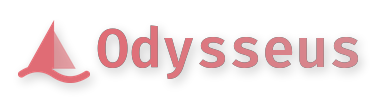
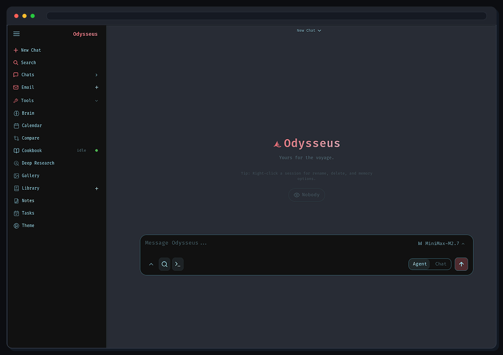

<p align="center">
  
</p>

<p align="center">
  A remodel of Pewdiepie's Odysseus, redesigned to suit students needs for self-hosted AI workspace for chat, agents, research, documents, email, notes, calendar, and local model workflows.
</p>

> This repo is forked from Pewdiepie's [Odysseus](https://github.com/pewdiepie-archdaemon/odysseus). Maintain by LY Pechvattana

<p align="center">
  <a href="#quick-start">Quick Start</a> ·
  <a href="docs/setup.md">Setup Guide</a> ·
  <a href="CHANGELOG.md">Changelog</a> ·
  <a href="ROADMAP.md">Roadmap</a>
</p>

<p align="center">
  <a href="https://repology.org/project/odysseus-ai/versions"></a>
</p>

<p align="center">
  
</p>

---

## Quick Start

> `dev` is the default branch and gets the newest changes first. Use [`main`](https://github.com/odysseus-dev/odysseus/tree/main) if you want the more curated branch.

```bash
git clone https://github.com/odysseus-dev/odysseus.git
cd odysseus
cp .env.example .env
docker compose up -d --build
```

Open `http://localhost:7000` when the containers are healthy. The first admin password is printed in `docker compose logs odysseus`.

Native installs, GPU notes, Windows/macOS instructions, HTTPS, and configuration live in the [setup guide](docs/setup.md).

## Features

- **Chat + Agents** — local/API models, tools, MCP, files, shell, skills, and memory.
- **Cookbook** — hardware-aware model recommendations, downloads, and serving.
- **Deep Research** — multi-step web research with source reading and report generation.
- **Compare** — blind side-by-side model testing and synthesis.
- **Documents** — writing-first editor with AI edits, suggestions, Markdown, HTML, CSV, and syntax highlighting.
- **Email** — IMAP/SMTP inbox with triage, tags, summaries, reminders, and reply drafts.
- **Notes, Tasks + Calendar** — reminders, todos, scheduled agent tasks, and CalDAV sync.
- **Extras** — gallery/image editor, themes, uploads, web search, presets, sessions, and 2FA.

## Demo

A full hover-to-play tour lives on the landing page: [`docs/index.html`](docs/index.html).

## Contributing

Help is welcome. The best entry points are fresh-install testing, provider setup bugs, mobile/editor polish, docs, and small focused refactors. See the [contributing guide](docs/contributing.md) and [ROADMAP.md](ROADMAP.md).

### Before You Start

- Search existing issues and pull requests before opening a new one.
- Prefer one bug fix or feature per pull request.
- Avoid broad rewrites, formatting-only changes, or moving many files unless the issue is specifically about structure.
- If you want to work on a large feature, open an issue first and describe the approach.

### Setup

Docker is the recommended path for normal testing:

```bash
git clone https://github.com/odysseus-dev/odysseus.git
cd odysseus
cp .env.example .env
docker compose up -d --build
```

Manual development uses Python 3.11+:

```bash
python3 -m venv venv
source venv/bin/activate
pip install -r requirements.txt
python -m uvicorn app:app --host 127.0.0.1 --port 7000
```

Windows is not actively tested. Docker on Linux or a Linux/macOS manual install is the safer path for now.

### Running Checks

Run the smallest relevant checks for your change:

```bash
python -m pytest
python -m py_compile app.py routes/*.py src/*.py
node --check static/js/<file-you-changed>.js
```

For Docker-related changes:

```bash
docker compose config
docker compose up -d --build
docker compose logs --tail=120 odysseus
```

Mention what you ran in the pull request description. If you could not run a check, say so.

### Pull Requests

Good pull requests usually include:

- A short explanation of the bug or feature.
- The files or areas changed.
- Manual test steps or automated test results from running the actual app, not just the test suite.
- Screenshots or short recordings for UI changes.
- Links to related issues, for example `Fixes #123`.

Please keep PRs small. Large PRs that mix unrelated cleanup, formatting, refactors, and behavior changes are much harder to review.

> **Auto-generated PRs.** If you are running an LLM agent (Devin, Cursor, OpenHands, Claude Code, or another coding agent) against this repo, please open an issue describing the problem first instead of opening a PR directly. Bulk agent-generated PRs that do not match the project's visual style or contribution format will be closed without review, even when the underlying code is correct.

### Style and Visual Changes

Odysseus has an intentional visual style. PRs that ignore it will be closed without merge, no matter how correct the underlying code is.

Before submitting any change that affects what the app looks like — buttons, icons, fonts, colors, spacing, layout, CSS, HTML, SVG, or any `static/js/` module that draws to the DOM — please:

1. **Run the app locally** and view the change in a browser. Type-checks and unit tests are not enough.
2. **Attach a screenshot or short clip** of the change in the running app. Add a mobile screenshot too if the change affects mobile.
3. **Match the existing visual language.** Specifically:
   - Reuse existing CSS variables (`--red`, `--fg`, `--bg`, `--card`, `--border`, …). Do not introduce new color values, font sizes, or spacing units.
   - Reuse existing button, input, card, and border classes. Do not invent parallel styling for similar widgets.
   - **No Unicode emoji in UI or code.** Use inline SVG matching the monochrome icon style already in `static/index.html`, or use plain text.
   - Use the monospaced `Fira Code` font for primary UI text. Do not override it.
   - The dark theme is the default; light-mode work must use the existing theme system rather than hard-coded values.
4. **Do not add parallel components.** If a similar widget already exists in the app, extend it instead of writing a new one.

If you are unsure whether a change is visual, treat it as visual and attach a screenshot.

### Code Conventions

Do not hardcode values that the project already exposes through a constant or helper. Hardcoded literals drift out of sync, break on non-default deployments, and reintroduce bugs that have already been fixed.

- **Filesystem paths:** never build writable paths from `Path(__file__)...` into the source tree, hardcode `/app/...`, or use a relative `data/...` string. Every persisted file and directory has a named constant in `src/constants.py` (for example `AUTH_FILE`, `USER_PREFS_FILE`, `SETTINGS_FILE`, `TTS_CACHE_DIR`, and `CHROMA_DIR`). Import and use that named constant; do not re-derive the path locally with `os.path.join(DATA_DIR, "x.json")` or `DATA_DIR / "x.json"`. `DATA_DIR` is the single place that reads `ODYSSEUS_DATA_DIR`, so use it directly only for dynamic paths that have no fixed name. If a data file or directory has no constant yet, add one to `src/constants.py`. The source tree is read-only in Docker and `/app/...` does not exist on native runs; guard directory creation so an unwritable path degrades gracefully instead of crashing at import.
- **Internal API / loopback URLs:** do not hardcode `http://localhost:7000`. Use `internal_api_base()` from `src.constants` (it honors `ODYSSEUS_INTERNAL_BASE` and `APP_PORT`).
- **Ports, limits, model lists, and similar:** reuse the existing constant if one exists. If it does not and the value is used in more than one place, add a constant rather than copying the literal.

If you need a value that has no constant or helper yet, add it to `src/constants.py`, the single source of truth for paths and configuration. `core/constants.py` only re-exports it for backward compatibility.

**Commits:** use [Conventional Commits](https://www.conventionalcommits.org), `type(scope): summary` (for example, `fix(search): ...`, `feat(notes): ...`, or `docs(contributing): ...`). Common types include `fix`, `feat`, `refactor`, `docs`, `test`, `chore`, and `ci`. Keep the subject short and imperative; put the reason in the body when it is not obvious.

### Issue Reports

For bugs, include:

- Install method: Docker, manual Python, WSL, and so on.
- OS, browser, and device if relevant.
- Exact steps to reproduce.
- Expected behavior and actual behavior.
- Logs, screenshots, or terminal output.

For model-serving issues, include:

- Backend: Ollama, vLLM, SGLang, llama.cpp, LM Studio, and so on.
- Model name.
- GPU/CPU and operating system.
- Cookbook task logs or server logs.

Issues with only “help,” “does not work,” or a screenshot without context may be closed as not actionable.

### Security

Do not post secrets, API keys, private logs, personal documents, or public IPs in issues or pull requests.

For security reports, follow [SECURITY.md](SECURITY.md).

## Security

Odysseus is a self-hosted workspace with powerful local tools. Keep auth enabled, keep private data out of Git, and do not expose raw model/service ports publicly. Deployment details are in the [setup guide](docs/setup.md#security-notes).

## Star History

<a href="https://www.star-history.com/?repos=odysseus-dev%2Fodysseus&type=date&legend=top-left">
 <picture>
   <source media="(prefers-color-scheme: dark)" srcset="https://api.star-history.com/chart?repos=odysseus-dev/odysseus&type=date&theme=dark&legend=top-left" />
   <source media="(prefers-color-scheme: light)" srcset="https://api.star-history.com/chart?repos=odysseus-dev/odysseus&type=date&legend=top-left" />
   
 </picture>
</a>

## License

AGPL-3.0-or-later -- see [LICENSE](LICENSE) and [ACKNOWLEDGMENTS.md](ACKNOWLEDGMENTS.md).
